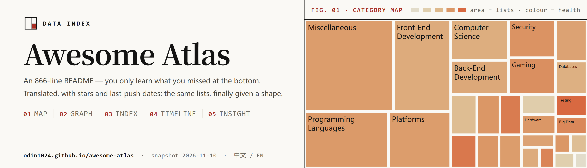
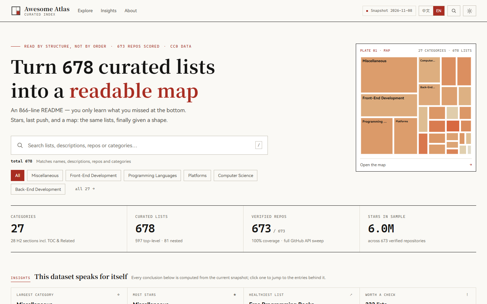
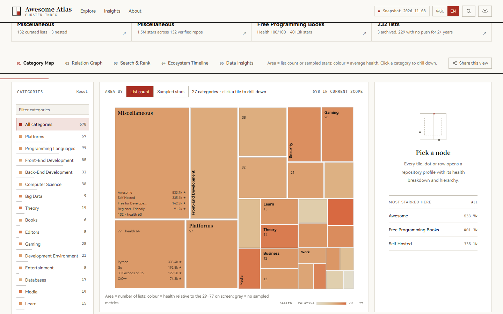
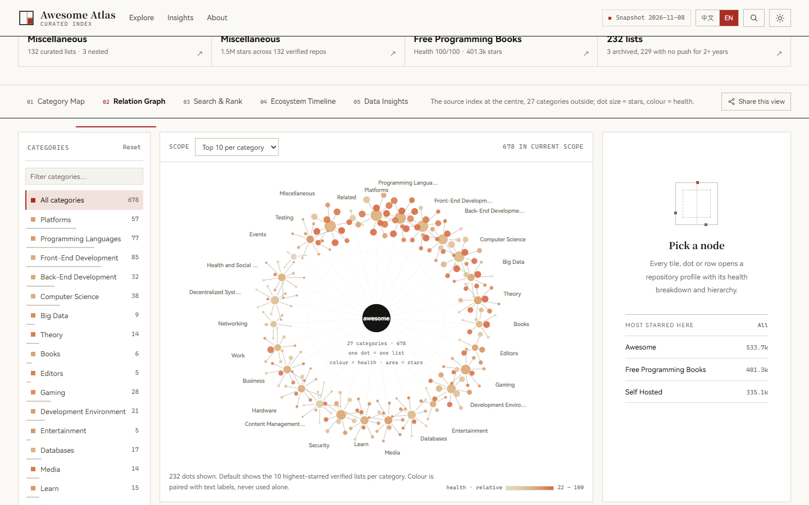
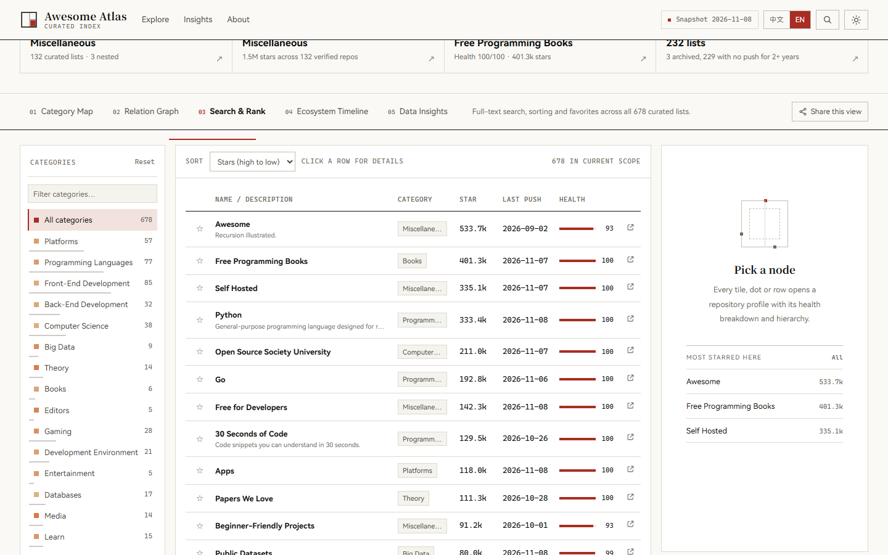
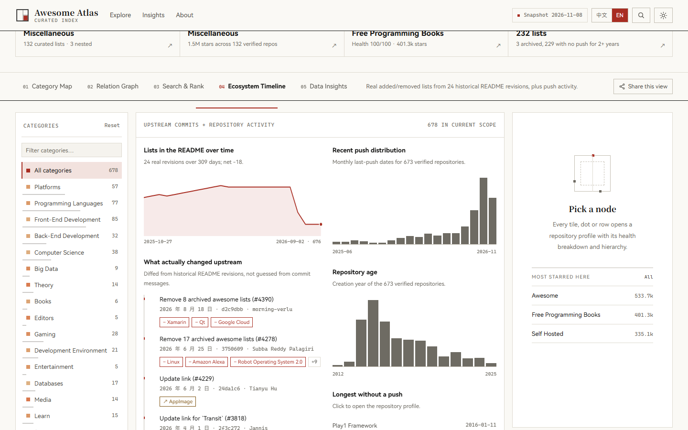
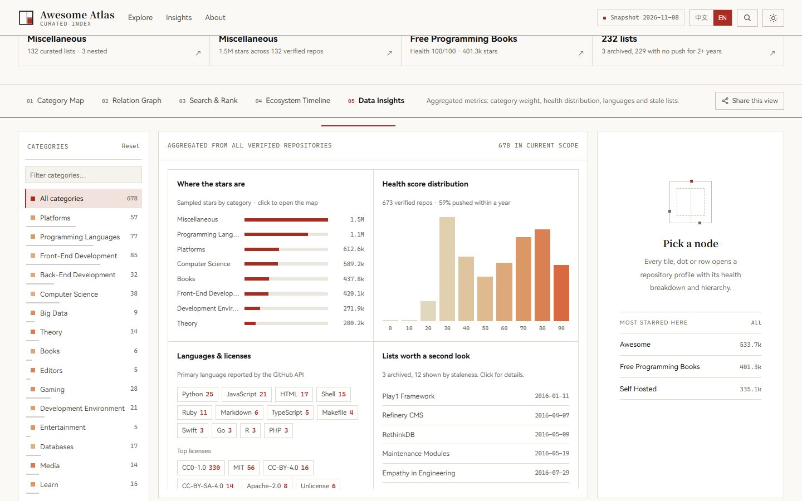
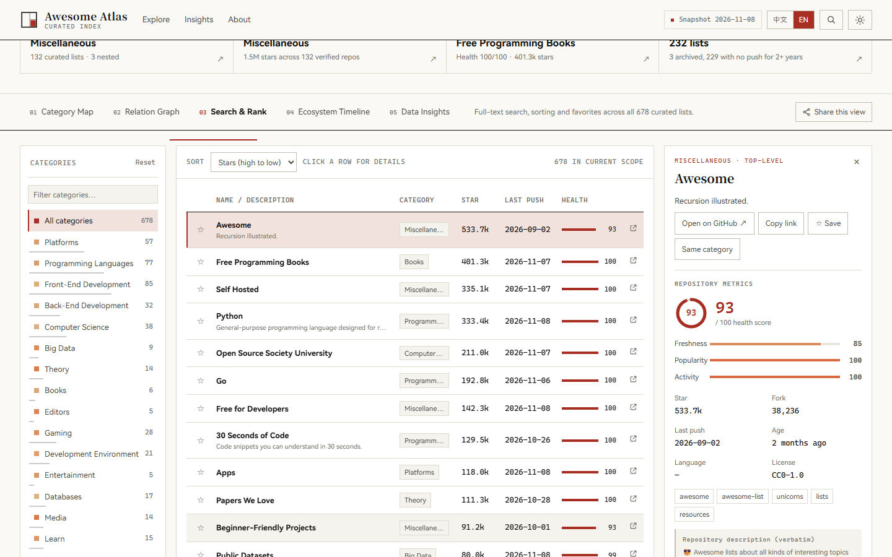
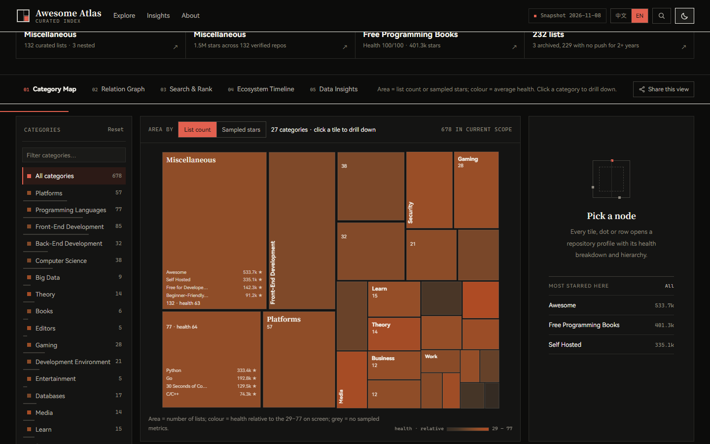
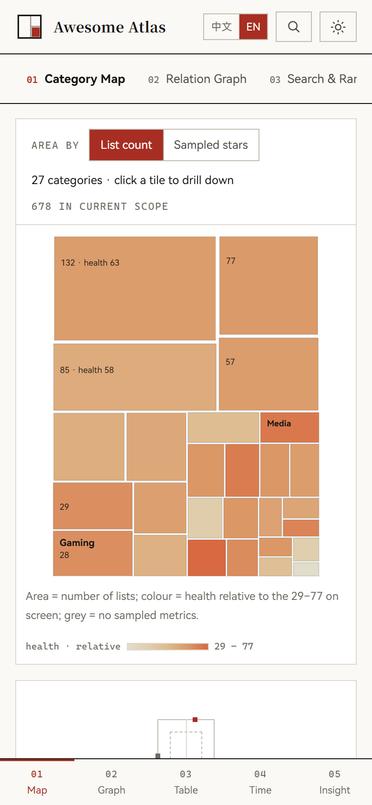

<p align="center"></p>

<p align="center">
  <a href="https://github.com/odin1024/awesome-atlas/releases"></a>
  <a href="https://github.com/odin1024/awesome-atlas/blob/main/LICENSE"></a>
  <a href="https://github.com/odin1024/awesome-atlas/search?l=javascript"></a>
  <a href="https://github.com/odin1024/awesome-atlas/commits/main"></a>
  <a href="https://github.com/odin1024/awesome-atlas/stargazers"></a>
  <a href="https://github.com/odin1024/awesome-atlas/forks"></a>
  <a href="https://github.com/odin1024/awesome-atlas/actions/workflows/validate.yml"></a>
</p>

<p align="center"><strong><a href="https://odin1024.github.io/awesome-atlas/">Open the site → odin1024.github.io/awesome-atlas</a></strong></p>

<p align="center"><a href="#what-this-is">What this is</a> · <a href="#five-views">Five views</a> · <a href="#data-pipeline">Data pipeline</a> · <a href="#cross-validation">Cross-validation</a> · <a href="README.md">中文</a></p>

## What this is

The `readme.md` of `sindresorhus/awesome` is 866 lines of English: 27 categories, 678 resources. It is well written, but it can only be read in order. You scroll from top to bottom and still have no idea what you missed, which field is growing, or which repository stopped shipping two years ago.

This project re-lays that same README as an explorable map and adds four dimensions the original does not have: **hierarchy, popularity, maintenance activity, and change over time**. Not one list item is missing. The lists simply have a shape now.

Three things you can actually do:

- **Read the structure.** The category map uses area for list count and colour for average health, so the busiest field is obvious at a glance. The relationship graph spreads all 27 categories into a galaxy around the source index.
- **Look one thing up.** Full-text search across 678 entries — Chinese, English, repo name, topics — with 7 sort orders, paging, favourites and export.
- **Check the numbers.** All 673 repositories were verified through the authenticated API for stars, forks and last push, at 100% coverage. When a fetch fails the previous snapshot is kept and its date is shown at the top of the page; nothing is filled with zeros or estimates.

This is not an attempt to typeset the README more prettily. Typography cannot answer "how is this list changing", and it cannot tell you whether a category is still alive.

## Five views

| View | Question it answers | How it encodes the answer |
| --- | --- | --- |
| 01 Category map | Which field is busiest | Treemap; area = list count or sampled stars (log), colour = average health, scaled to the range present in the current view and printed in the legend. Picking a category in the sidebar or clicking a tile focuses that category's lists |
| 02 Relationship graph | How categories and lists are organised | Radial galaxy: source index at the centre, 27 categories on the outer ring; dot size = stars, colour = health |
| 03 Search and ranking | Finding one specific list | Full-text search over 678 entries (Chinese / English / repo name / topics), 7 sort orders, paging, favourites, export |
| 04 Timeline | How the index changes | Real diffs across 24 historical README versions, push distribution over the last 18 months for verified repos, repository creation years |
| 05 Insights | What the global distribution looks like | Category weights, health distribution, language mix, archived and stalled lists |

Interaction: the map preview on the fold links straight into the workspace; global search (`/` or `Ctrl+K` opens a command palette); URL state sync (view / category / search / sort / selection / language are all shareable, and back-forward does not reload the page); favourites and comparison in localStorage; share the current view; light and dark themes; mobile bottom navigation; a "back to top" control in the footer; keyboard access; `prefers-reduced-motion` fallbacks. Colour never carries information on its own.

## Screenshots



| Category map · area = list count, colour = average health | Relationship graph · source index at the centre, 27 categories around it |
| --- | --- |
|  |  |
| **Search and ranking · 678 entries, 7 sort orders** | **Timeline · diffs across 24 real README versions** |
|  |  |
| **Insights · the full metrics set, re-aggregated** | **Entry profile · how the health score is built** |
|  |  |

| Dark theme | Mobile (390px) |
| --- | --- |
|  |  |

## Chinese first, and why

The site ships two states and no more. The `中文 / EN` switch in the header changes interface copy, the fold, section titles and descriptions together — the earlier side-by-side layout squeezed long descriptions into two lines of small type in a narrow column, so it was removed.

- 27 category names, 466 descriptions and 224 additional hints are all hand-checked. Proper nouns (React, Kubernetes, Rust…) keep their original spelling instead of being transliterated. Another 212 entries have no description upstream at all: they get a Chinese hint, never invented copy.
- Chinese search, 万 / 亿 number formatting, Chinese dates, explicit markers on outbound links, and no request to any overseas CDN or font service. The page opens on a mainland Chinese network without a proxy.

## Data pipeline

```
source/readme.md  →  build-data.mjs     →  data/catalog.json (structure)
                  →  enrich-full.mjs   →  metrics for all 673 repos (GitHub GraphQL, batched aliases)
                  →  history.mjs       →  data/history.json (diffs across 24 README versions)
                  →  upstream.json     →  upstream commits and fetch coverage
source/descriptions.tsv → i18n.json    →  Chinese names / descriptions / hints
                  →  bundle.mjs        →  data/catalog.js (the only data source the page loads)
                  →  validate.mjs + browser-check.py (two independent layers)
                  →  make-banner.py    →  docs/banner.png, badges and social preview
```

- **Parsing.** A line-level tokenizer rebuilds H2 sections, Markdown links, tab-indented parent/child relationships and raw HTML blocks: 597 top-level entries plus 81 children. Link-less labels such as `Linux` and `macOS` stay as `kind: label`, and reserved paths like `github.com/topics/awesome` are not counted as repositories.
- **Metrics.** An authenticated GitHub API run covers **673 / 673 (100%)** of repositories with stars, forks, `pushedAt`, `createdAt`, language, licence, topics and archived state — 5,979,356 stars in total. A failed fetch keeps the previous snapshot rather than writing a zero.
- **Health score.** `0.45 × freshness(pushed_at) + 0.35 × popularity(log10 stars) + 0.20 × activity(forks / archived)`, each term on a 0–100 scale, with the breakdown shown in the detail panel. No black box.
- **Timeline.** `history.mjs` pulls 24 real versions through the Contents API and diffs them pairwise: 9 additions, 27 removals, 2 relinked URLs. None of it is simulated.

## Repository layout

```
index.html            single page, no build step
assets/app.js         every view and interaction (IIFE, no framework)
assets/styles.css     design tokens and layout
data/catalog.js       the only data source the page loads (bundled from catalog.json + i18n.json)
data/i18n.json        category names, descriptions, hints for entries without one
source/readme.md      upstream snapshot, sha256 recorded in the catalogue
scripts/              fetch, bundle, validate, render
docs/                 README headers, share card, screenshots (en/ = English UI), report
```

## Visual system

The layout follows **Editorial Grid / Swiss Style** because it serves the subject — an index — rather than decorating it: order comes from the grid, type scale and hairline rules, not from shadows and rounded corners.

- **Colour.** Paper `#faf9f5`, ink `#141413`, one red accent `#a82d22`; the dark theme inverts the surfaces and lifts the accent to `#e2604f`. The whole site uses a single accent hue (measured at 5° in light mode, 7° in dark).
- **Shape.** Zero radius, no shadows, no gradients, no frosted glass. Columns are separated by 1px hairlines instead of stacked cards. The only rounded corners left are functional: progress bars and switches.
- **Type.** Serif headings, sans body, monospace data, all from system font stacks (PingFang SC / HarmonyOS Sans SC / Microsoft YaHei / Songti SC). **No Google Fonts** — they do not load in mainland China, and a failed font request takes the whole layout down with it.
- **Data ramp.** The scale stretches over the observed health range instead of a fixed 0–100, and stays light enough for ink text to clear 4.5:1 — stone → sand → apricot → terracotta. The dark theme uses the reverse ramp. Legend swatches come from the same RAMP array as the tiles, so they cannot drift apart.
- **Executable constraints.** Contrast ≥ 4.5:1, one accent hue, zero radius, no gradient text, no emoji as icons, touch targets ≥ 44px, `prefers-reduced-motion` support — all asserted in `validate.mjs`. A rule written only in a document gets forgotten; a rule written as a test does not.

## Run it locally

```bash
python -m http.server 8765     # or npm run serve
# open http://127.0.0.1:8765
```

Reproduce the data and the images:

```bash
npm run build:data                       # parse source/readme.md
node scripts/enrich-full.mjs             # needs GitHub authorisation
node scripts/history.mjs                 # pull historical README versions
node scripts/bundle.mjs                  # build the front-end data file
npm run validate                         # data-layer checks (run this first)
npm run check:browser                    # real-browser checks
npm run banner                           # re-render both headers and the social card
npm run shots                            # re-render docs/screenshots/ (Chinese UI)
ATLAS_LANG=en npm run shots              # re-render docs/screenshots/en/ (English UI)
```

The badges under the header are not drawn images. Version, license, top language, last commit, stars and forks are read from GitHub by shields.io and update themselves, so adding a check never leaves a stale number in a picture. Screenshots ship in two sets: `docs/screenshots/` is the Chinese UI, `docs/screenshots/en/` the English one, and this file only references the latter.

## Cross-validation

| Layer | Script | Coverage | Result |
| --- | --- | --- | --- |
| Data | `scripts/validate.mjs` | Re-counts the raw README by an independent method and checks parsing, URL normalisation, metric ranges, i18n coverage, history diffs, artifact completeness, interface and design constraints, ΔE spacing of the colour ramp, tile text contrast, the brand mark, the subtitle line break, and the consistency of the two READMEs | **95 / 95** |
| Browser | `scripts/browser-check.py` | A real headless Chrome **clicks every control** (header anchors, the fold's map plate, 5 views, sidebar filters and 3 switches, area basis, display range, sorting, paging, inline favourites, 4 detail buttons, timeline ranking, insight bars, command palette, 2 footer buttons), plus scroll restoration, both language states, graph label collisions, table column overflow, canvas legend and footnote visibility, tile colour spacing, tile line height, mark geometry, subtitle line break, 5 mobile tabs with measured 44px touch targets, back/forward view restore, rendering with localStorage denied, command-palette focus trap and restore, arrow-key tabs, keyboard row activation and console errors | **127 / 127**, 0 console errors |
| Production | same, with `ATLAS_BASE=...` | The same assertions run against the deployed site, so "green locally, broken online" cannot happen | re-run after each deploy |

Full report and desktop / mobile screenshots: [`docs/VALIDATION.md`](docs/VALIDATION.md), `docs/screenshots/` (中文) and `docs/screenshots/en/` (English).

## Deploying to GitHub Pages

Live at **https://odin1024.github.io/awesome-atlas/**. The repository root is the Pages root; `.nojekyll` skips the Jekyll pass.

**Option 1: plain git** (when `github.com:443` is reachable)

```bash
git remote add origin https://github.com/<user>/awesome-atlas.git
git push -u origin main
```

**Option 2: REST only** (when `github.com` is blocked by a proxy and only `api.github.com` is reachable)

```bash
GH_TOKEN=<token with Contents write> node scripts/deploy-pages.mjs
```

The script uploads every file as a Git blob and commits them as **one atomic commit** (`blob → tree → commit → ref`), then enables Pages and prints the URL. `GH_DRY=1` prints the plan without writing; `GH_REPO` / `GH_BRANCH` retarget it.

### Three traps we actually hit

All three are handled in the script; do not remove the handling when rewriting it.

1. **GitHub App tokens are read-only here.** The `ghu_` token issued by the WorkBuddy connector carries `contents: read`, so every write path (create repo, `git/blobs`, Contents API) returns `403 Resource not accessible by integration`. Deploying needs a classic PAT (`repo` scope) or a fine-grained PAT with Contents write.
2. **An empty repository cannot take a blob.** With no commits, `git/blobs` and `git/refs` both return `409 Git Repository is empty.` One file has to be written through the Contents API first to create a tree; the script seeds `.nojekyll`.
3. **Enabling Pages needs `administration: write`.** A fine-grained token with only Pages write fails. Either add Administration write, or set it by hand in **Settings → Pages** → **Deploy from a branch** → `main` → `/ (root)`.

### Fallback without credentials

```bash
node scripts/bundle-single.mjs
```

Inlines styles, data and scripts into a single `dist/index.html` (846 KB) that can be dragged into the GitHub web uploader. It passes the full browser suite as tested.

> One trap worth remembering: in `String.prototype.replace`, `$$` in a **string** replacement collapses to `$`. `app.js` declares both `$` (querySelector) and `$$` (querySelectorAll), so the first version turned `const $$ =` into a second `const $ =` and every `$$(...)` call silently degraded to a single-element query — the page still rendered, multi-element logic was wrong, nothing threw. Switching to a replacement **function** fixed it, and a post-build assertion now requires every source chunk to appear verbatim in the output.

### Repository settings

- **About**: tick **Use your GitHub Pages website** so the homepage field fills itself in. Suggested topics: `awesome-list`, `data-visualization`, `treemap`, `chinese`.
- **Social preview**: `Settings → General → Social preview` → upload `docs/social-preview.png` (1200×630). Without it, pasting the repo link into a chat app shows GitHub's generic white card.

## Licence and scope

The code here — HTML, CSS, JS and every script — is **MIT** licensed, see [`LICENSE`](LICENSE): static files, no build step, no dependencies. Source content comes from `sindresorhus/awesome` (CC0-1.0). Original names, descriptions and links are kept; the Chinese translation is this project's addition, and the data stays CC0. Stars, forks and last-push dates are **point-in-time snapshots**, not live data. The timeline reflects changes to the upstream README and the push distribution of repositories, not a quality rating of the lists themselves. Every statistical definition — and every honest limitation — is written into the data note in the page footer.

<p align="center"><a href="#what-this-is">Back to top</a> · <a href="README.md">以中文阅读 →</a></p>
