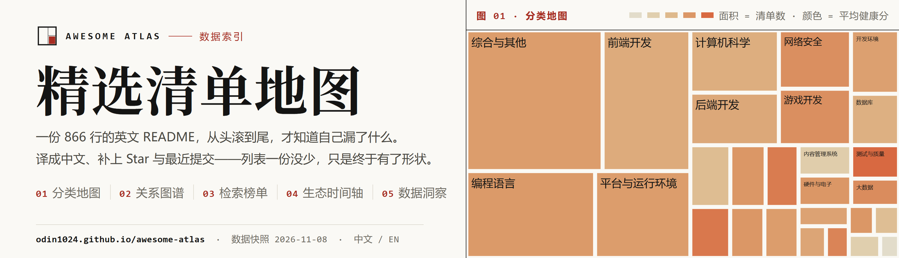
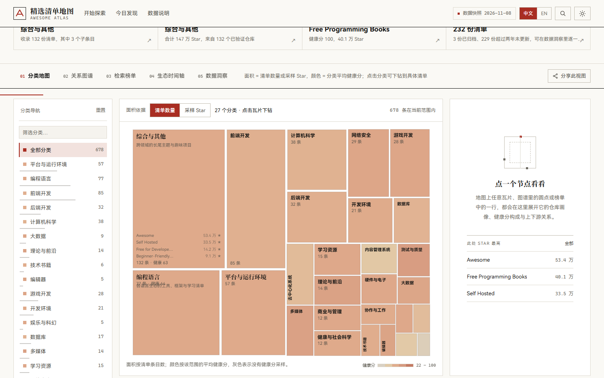
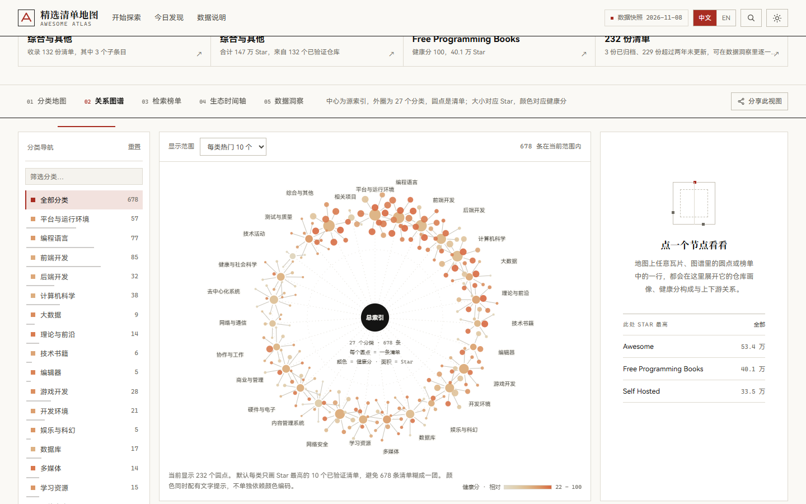
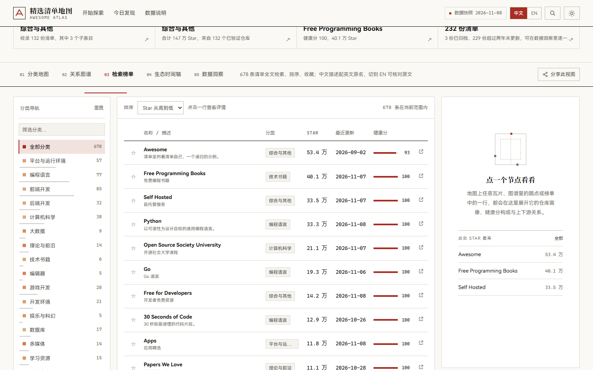
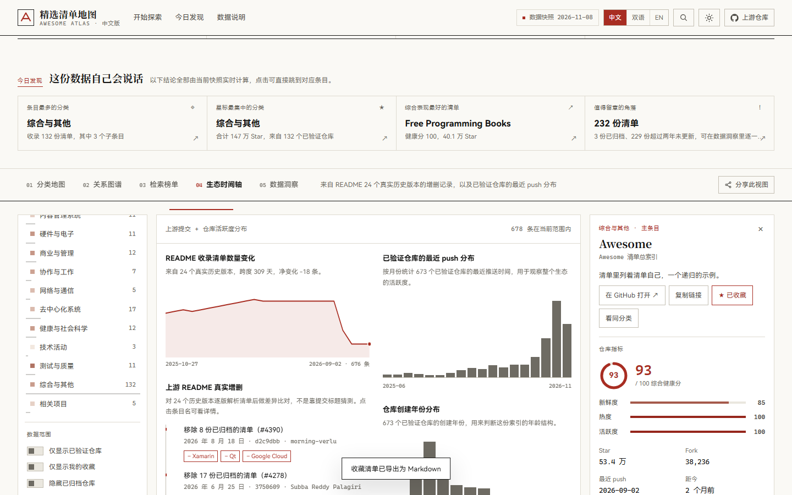
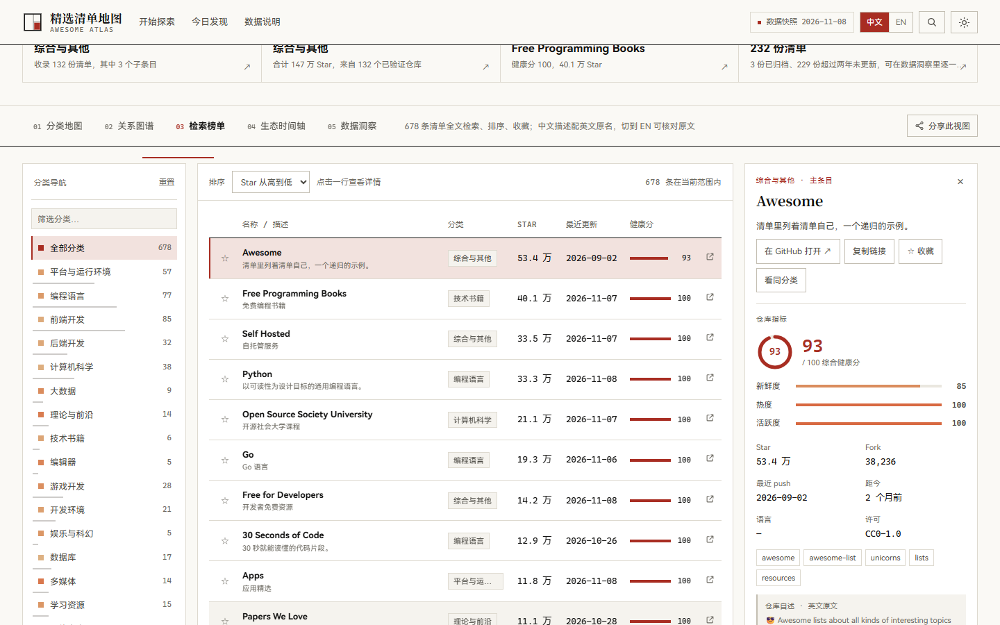
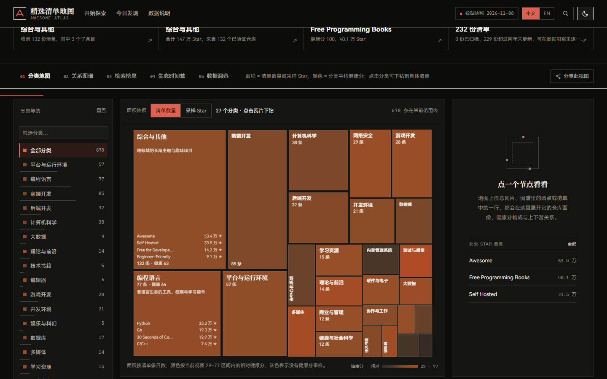

<p align="center"></p>

<p align="center">
  
  
  
  
</p>

<p align="center"><strong><a href="https://odin1024.github.io/awesome-atlas/">在线打开 → odin1024.github.io/awesome-atlas</a></strong></p>

<p align="center"><a href="#这是什么">这是什么</a> · <a href="#五个视图">五个视图</a> · <a href="#数据管线">数据管线</a> · <a href="#交叉验证">交叉验证</a> · <a href="README.en.md">English</a></p>

## 这是什么

`sindresorhus/awesome` 的 `readme.md` 是一份 866 行的英文清单，27 个分类、678 条资源。它写得好，但只能按顺序读：从头滚到尾，仍然不知道自己漏了什么，也看不出哪个领域在长、哪个仓库已经停更。

这个项目把同一份 README 重排成一张可探索的地图，补上原文里不存在的四个维度——**层级关系、仓库热度、维护活跃度、时间演化**。列表一份没少，只是终于有了形状。

具体能做的三件事：

- **读结构。** 分类地图用面积表示清单数、颜色表示平均健康分，一眼看出哪个领域最繁荣；关系图谱把 27 个分类摊成星系，看它们怎么围着源索引转。
- **查一条。** 678 条全文检索，中文、英文、仓库名、topics 都能搜；7 种排序、分页、收藏、导出。
- **验真伪。** 673 个仓库全部用授权 API 核过 stars、forks、最近提交，覆盖率 100%。采集失败就保留上一版快照并在页面顶部标注日期，绝不用 0 或估算值填充。

它不追求「把 README 排版得好看点」。排版解决不了「这份列表在怎么变」，也回答不了「这个分类还活着吗」。

## 五个视图

| 视图 | 回答的问题 | 编码方式 |
| --- | --- | --- |
| 01 分类地图 | 哪个领域最繁荣 | Treemap，面积 = 清单数或采样 Star（对数），颜色 = 平均健康分（按当前视图内的区间相对着色，图例打印该区间）；侧栏选分类或点瓦片都直接聚焦到该分类的清单 |
| 02 关系图谱 | 分类与清单如何组织 | 径向星系，中心为源索引、外圈 27 个分类；圆点大小 = Star，颜色 = 健康分 |
| 03 检索榜单 | 找到某一份具体清单 | 678 条全文检索（中文 / 英文 / 仓库名 / topics）、7 种排序、分页、收藏、导出 |
| 04 生态时间轴 | 这个索引在怎么变 | 24 个真实 README 历史版本的增删 diff、已验证仓库近 18 个月的 push 分布、仓库创建年份分布 |
| 05 数据洞察 | 全局分布长什么样 | 分类权重、健康分分布、语言构成、归档与停滞清单的聚合统计 |

交互：首屏的分类地图预览可直接点进地图；全局搜索（`/` 或 `Ctrl+K` 唤起命令面板）、URL 状态同步（视图 / 分类 / 搜索 / 排序 / 选中项 / 语言均可分享，前进后退不重载页面）、收藏与对比存 localStorage、分享当前视图、深浅色主题、移动端底部导航、页脚「回到顶部」、键盘可访问、`prefers-reduced-motion` 降级。颜色从不单独承担信息编码。

## 界面预览


| 分类地图 · 面积 = 清单数，颜色 = 平均健康分 | 关系图谱 · 中心为源索引，外圈 27 个分类 |
| --- | --- |
|  |  |
| **检索榜单 · 678 条全文检索与 7 种排序** | **生态时间轴 · 24 个真实 README 版本的增删** |
|  |  |
| **数据洞察 · 全量指标的重新聚合** | **条目画像 · 健康分构成与上下游关系** |
|  |  |

| 深色主题 | 移动端（390px） |
| --- | --- |
|  |  |

## 中文与国内友好

- **两态语言**：顶栏 `中文 / EN` 一键切换。中文态显示译文，EN 态把界面文案、首屏、栏目标题与描述一并切到英文（并列对照会让长描述在窄栏里挤成两行小字，已移除）。
- 27 个分类译名、466 条描述译文、224 条补充提示，全部人工校订；专有名词（React、Kubernetes、Rust…）保留英文原名，不硬译。另有 212 条源清单根本没有描述，只给中文提示，不代写。
- 中文检索、万 / 亿计数、中文日期、外链明确标注、页面不请求任何境外 CDN 或字体，国内网络可直接打开。

## 数据管线

```
source/readme.md  →  build-data.mjs     →  data/catalog.json（结构解析）
                  →  enrich-full.mjs   →  673 个仓库全量指标（GitHub GraphQL 批量 alias）
                  →  history.mjs       →  data/history.json（24 版 README 真实 diff）
                  →  upstream.json     →  上游提交记录与采集覆盖率
source/descriptions.tsv → i18n.json    →  中文译名 / 译文 / 提示
                  →  bundle.mjs        →  data/catalog.js（前端唯一数据源）
                  →  validate.mjs + browser-check.py（两层交叉验证）
                  →  make-banner.py    →  docs/banner.png 与 docs/social-preview.png
```

- **结构解析**：行级 tokenizer 还原 H2 章节、Markdown 链接、Tab 缩进的父子关系与 HTML 区块；597 个主条目 + 81 个子条目；`Linux`、`macOS` 这类无链接纯标签保留为 `kind: label`；`github.com/topics/awesome` 这类保留路径不当作仓库。
- **指标**：授权 GitHub API 全量核验，**673 / 673（100%）** 仓库拿到 stars、forks、pushedAt、createdAt、language、license、topics、archived，合计 5,979,356 Star。采集失败时保留上一版快照，页面顶部始终显示「数据快照」日期。
- **健康分**：`0.45 × 新鲜度(pushed_at) + 0.35 × 热度(log10 stars) + 0.20 × 活跃度(forks / 归档状态)`，三个分量都在 0–100，右侧详情面板展示构成，不做黑箱打分。
- **时间轴**：`history.mjs` 从 Contents API 拉取 24 个真实历史版本逐版比对，得到新增 9 / 移除 27 / 换链接 2，不是模拟数据。

## 仓库结构

```
index.html            单页入口，无构建步骤
assets/app.js         全部视图与交互（IIFE，无框架）
assets/styles.css     设计令牌与版式
data/catalog.js       前端唯一数据源（由 catalog.json + i18n.json 打包）
data/i18n.json        分类译名、描述译文、无描述条目的中文提示
source/readme.md      上游快照，sha256 记录在 catalog 里
scripts/              采集、打包、验证、出图
docs/                 README 横幅、徽章、截图与验证报告
```

## 视觉体系

版式取 **Editorial Grid / Swiss Style**，因为它服务的是「索引」这件事本身：靠栅格、字号层级和发丝线建立秩序，而不是靠阴影和圆角制造层次。

- **颜色**：纸白 `#faf9f5` / 墨色 `#141413` / 单一朱红强调色 `#a82d22`；深色主题整体反转，强调色提亮为 `#e2604f`。全站只有一个强调色相（实测浅色 5°、深色 7°）。
- **形状**：圆角 0，无阴影、无渐变、无毛玻璃。分栏靠 1px 发丝线，不靠卡片堆叠。唯一保留的功能性圆角是进度条与开关。
- **字体**：标题宋体、正文黑体、数据等宽，全部使用系统中文字体栈（PingFang SC / HarmonyOS Sans SC / Microsoft YaHei / Songti SC）。**不请求 Google Fonts**——那在国内打不开，字体加载失败会让整页排版垮掉。
- **数据色阶**：按观测到的健康分区间拉伸（而非固定 0–100），并把明度控制在墨色文字仍能过 4.5:1 的区间内，用色相与饱和度区分高低——岩灰 → 沙 → 杏 → 陶土。深色主题使用反向色阶。图例色块由同一份 RAMP 生成，不会与地图实际颜色脱钩。
- **可执行的设计约束**：对比度 ≥ 4.5:1、单一强调色相、0 圆角、无渐变文字、无 emoji 当图标、触控 ≥ 44px、`prefers-reduced-motion` 降级，全部写成 `validate.mjs` 里的断言——规范写在文档里会被遗忘，写成测试才不会。

## 本地运行

```bash
python -m http.server 8765     # 或 npm run serve
# 打开 http://127.0.0.1:8765
```

复现数据与图片：

```bash
npm run build:data                       # 解析 source/readme.md
node scripts/enrich-full.mjs             # 需要 GitHub 授权
node scripts/history.mjs                 # 拉取上游历史版本
node scripts/bundle.mjs                  # 生成前端数据
npm run validate                         # 数据层验证（先跑，报告才完整）
npm run check:browser                    # 浏览器实机验证
npm run banner                           # 重新生成横幅、徽章与社交预览图
npm run shots                            # 重新生成 docs/screenshots/
```

徽章上的断言数来自 `data/validation.json` 与 `data/browser-check.json`，所以顺序是 **validate → check:browser → banner**。数字不是手写的，改一次检查项就要重出一次图。

## 交叉验证

| 层 | 脚本 | 覆盖 | 结果 |
| --- | --- | --- | --- |
| 数据 | `scripts/validate.mjs` | 用独立方法重新统计原始 README，校验解析、URL 归一化、指标范围、i18n 覆盖、历史 diff、产物完整性、界面与设计约束，色阶的 ΔE 落差与瓦片文字对比度，品牌标记、副标题断行，以及中英两版 README 的一致性 | **84 / 84** |
| 浏览器 | `scripts/browser-check.py` | 真实 Chrome 无头浏览器**逐个点击每个控件**（顶栏锚点、首屏地图板、5 个视图、侧栏筛选与 3 个开关、面积依据、显示范围、排序、分页、行内收藏、详情 4 个按钮、时间轴榜单、洞察条形、命令面板、页脚 2 个按钮）、刷新回顶、语言两态、图谱标签几何碰撞、表格列溢出、画布图例与脚注可见、瓦片配色落差与图例区间、瓦片内文字行距、品牌标记几何、副标题断行位置、移动端 5 个标签、控制台异常 | **119 / 119**，控制台 0 异常 |
| 线上 | 同上，`ATLAS_BASE=...` | 同一套断言直接打向已部署站点，避免「本地绿、线上坏」 | 部署后同套复核 |

详细报告与桌面 / 移动端截图见 [`docs/VALIDATION.md`](docs/VALIDATION.md) 和 `docs/screenshots/`。

## 部署到 GitHub Pages

线上地址：**https://odin1024.github.io/awesome-atlas/** 。站点根目录即 Pages 根目录，`.nojekyll` 会跳过 Jekyll 处理。

**方式一：常规 git**（`github.com:443` 可达时）

```bash
git remote add origin https://github.com/<用户名>/awesome-atlas.git
git push -u origin main
```

**方式二：纯 REST API**（`github.com` 被代理拦截、只有 `api.github.com` 可达时）

```bash
GH_TOKEN=<有 Contents 写权限的令牌> node scripts/deploy-pages.mjs
```

脚本把站点文件传为 Git blob 并**合并为一次原子提交**（`blob → tree → commit → ref`），再尝试启用 Pages 并回显地址。`GH_DRY=1` 只打印清单；`GH_REPO` / `GH_BRANCH` 指定目标仓库与分支。

### 三个实际撞到过的坑

脚本里都已处理，改写部署逻辑时不要拆掉：

1. **GitHub App 令牌是只读的。** WorkBuddy 连接器发的 `ghu_` 令牌带 `contents: read`，对任何写入路径（建库、`git/blobs`、Contents API）都返回 `403 Resource not accessible by integration`。部署必须用 classic PAT（`repo` scope）或 fine-grained PAT（Contents 写）。
2. **空仓库不能直接写 blob。** 没有任何提交的仓库，`git/blobs` 与 `git/refs` 一律返回 `409 Git Repository is empty.`。必须先用 Contents API 写一个文件建立第一棵树，脚本用 `.nojekyll` 作种子。
3. **开启 Pages 需要 `administration: write`。** 只给 Pages 写权限的 fine-grained 令牌会失败。两条路：给令牌加 Administration 写，或在 **Settings → Pages** 手动把 Source 设为 **Deploy from a branch**、分支 `main`、目录 `/ (root)`。

### 无凭据时的兜底

```bash
node scripts/bundle-single.mjs
```

把样式、数据和脚本内联成单个 `dist/index.html`（816 KB），可直接拖进 GitHub 网页上传，已实测通过全部浏览器检查。

> 内联有个值得记的陷阱：`String.prototype.replace` 的**字符串**替换串里，`$$` 会塌缩成一个 `$`。`app.js` 同时声明了 `$`（querySelector）和 `$$`（querySelectorAll），第一版因此把 `const $$ =` 写成第二个 `const $ =`，全文 `$$(...)` 调用静默退化成单元素查询。改用替换**函数**后解决，并加了「每段内容必须逐字出现在产物里」的构建后断言。

### 仓库主页设置

- **About**：勾选 **Use your GitHub Pages website**，主页地址自动填成线上地址；Topics 建议 `awesome-list`、`data-visualization`、`treemap`、`chinese`。
- **社交预览图**：`Settings → General → Social preview` 上传 `docs/social-preview.png`（1200×630）。不传的话，把仓库链接发到聊天工具里只会显示 GitHub 自动生成的白底卡片。

## 许可与边界

源内容来自 `sindresorhus/awesome`（CC0-1.0），本站保留原始名称、描述与链接，中文译文为本站增补。Star / Fork / 最近更新是**采样时点快照**，不是实时数据；生态时间轴反映的是上游 README 的变更与仓库 push 分布，不代表清单本身的质量评级。页面所有统计口径与「诚实边界」都写在页脚的数据说明里。

<p align="center"><a href="#这是什么">回到顶部</a> · <a href="README.en.md">Read in English →</a></p>
