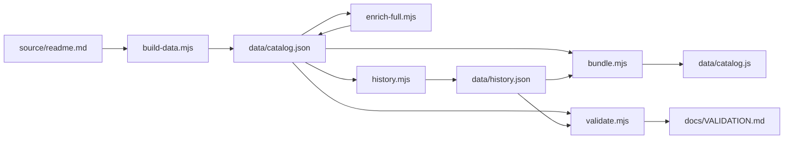
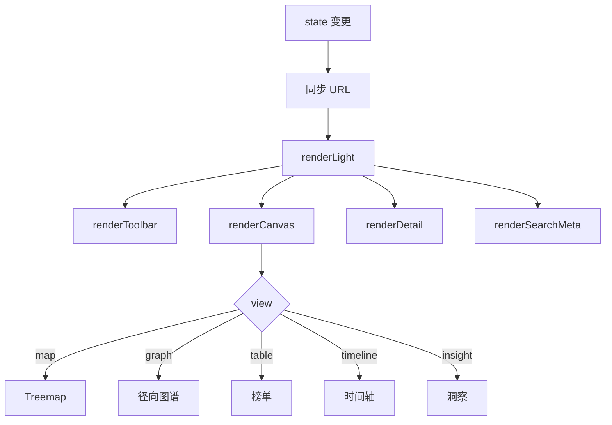

# 方案设计文档 · Awesome Atlas

> 定位：README 回答「这是什么、怎么用」，本文回答「为什么这么设计、怎么实现、边界在哪」。
> 版本：v1.1.0（快照 `2026-11-10T11:29:02.769Z`，上游 `465cd78…`）。

---

## 0. 一页纸摘要

| 项 | 内容 |
| --- | --- |
| 问题 | 678 条精选清单的唯一入口是一篇 866 行 Markdown，只能顺序读 |
| 做法 | 把 README 当数据库重建：解析 → 补全指标 → 差分历史 → 生成静态数据 → 五视图呈现 |
| 交付物 | 4 个运行时文件（`index.html` / `styles.css` / `app.js` / `catalog.js`），无框架、无构建、无第三方请求 |
| 数据规模 | 27 分类 / 678 条 / 673 个 GitHub 仓库 / 466 条中文译述 / 24 个历史版本 |
| 质量基线 | 数据层 95 项断言、真实浏览器 127 项断言、触控目标 ≥ 44px、控制台 0 报错 |
| 核心不变量 | 每个展示数字都能被脚本复算；采集失败保留旧快照并标注日期；未命中不等于 0 分 |

---

## 1. 问题与目标

### 1.1 用户与场景

| 用户 | 具体任务 | 原做法的成本 |
| --- | --- | --- |
| 想入门某方向的开发者 | 「前端这个方向还有哪些清单值得订阅」 | 在几万字里 Ctrl+F，逐条点开外链才能判断是否停更 |
| 做技术选型的人 | 「这几个仓库哪个还活着」 | 手工开标签页、抄 stars、比对最近提交 |
| 内容创作者 / 布道者 | 「这个生态的结构是什么样」 | 无法量化，只能凭印象描述 |
| 需要汇报的人 | 「把这一屏发出去」 | 截图 + 手工统计，口径无法复现 |

四条场景的共同点：问题不是「内容不够」，而是**没有结构、没有时间维度、没有可分享的状态**。

### 1.2 设计目标（可验收）

| 编号 | 目标 | 验收方式 |
| --- | --- | --- |
| G1 | 列表零丢失 | `validate.mjs` 用独立解析方法重新统计原始 README，逐项与 `catalog.json` 比对 |
| G2 | 每个数字可追溯 | 页面上出现的 678 / 27 / 673 / 466 / 24 全部来自数据文件，断言交叉校验 |
| G3 | 五类问题各有对应视图 | 每个视图有明确「回答什么」，不用同一张表格换皮 |
| G4 | 可访问性可测量 | 对比度 ≥ 4.5:1、触控 ≥ 44×44、键盘走完主链路，全部写成断言 |
| G5 | 国内网络直开 | 运行时零第三方请求，字体只用系统字体栈 |
| G6 | 数据诚实 | 失败不填 0；`unavailable` 与「健康分 0」是两种状态 |

### 1.3 非目标

- 不做实时数据：快照是采集时点，不做轮询或 WebSocket。
- 不做账号体系：收藏只存本地，不采集任何个人信息。
- 不做通用 awesome 站：只服务 `sindresorhus/awesome` 这一份上游，保证口径可复算。
- 不做移动 App / 小程序：Web 单形态，避免多端维护成本。

---

## 2. 产品方案

### 2.1 信息架构

```
首屏（问题陈述 + 搜索 + 地图预览板）
  └─ 数据概览（4 张指标卡）
  └─ 今日发现（4 条由快照实时算出的结论，可点击跳转）
  └─ 工作区
       ├─ 视图栏（5 个视图 + 当前视图说明 + 分享）
       ├─ 侧栏（分类导航 / 数据范围开关 / 收藏 / 图例）
       ├─ 画布（当前视图）
       └─ 详情面板（选中条目的仓库画像）
  └─ 数据说明（来源、解析口径、健康分、边界）
  └─ 页脚
```

三层结构对应三种进入方式：**浏览**（首屏 → 预览板 → 地图）、**检索**（搜索框 / `Ctrl+K`）、**深链**（带参数的 URL 直接落到某条清单）。

### 2.2 五个视图的职责边界

| 视图 | 回答的问题 | 编码方式 | 明确不承担 |
| --- | --- | --- | --- |
| 01 分类地图 | 哪个领域最繁荣 | 二叉切分 Treemap；面积 = 清单数或采样 Star（对数），颜色 = 平均健康分 | 不负责精确比较两个相近的值（差异靠数字标签读） |
| 02 关系图谱 | 分类与清单如何组织 | 径向星系，中心为源索引，外圈 27 个分类，圆点大小 = Star | 不负责列出全部 678 条（按范围采样） |
| 03 检索榜单 | 找到某一份具体清单 | 全文检索、7 种排序、分页、收藏、导出 | 不负责呈现结构，只做定位 |
| 04 生态时间轴 | 这个索引在怎么变 | 24 个真实版本的增删 diff、近 18 个月 push 分布、创建年份分布、停滞榜 | 不解释变更原因（只呈现事实） |
| 05 数据洞察 | 全局分布长什么样 | 分类权重、健康分直方、语言构成、归档与停滞聚合 | 不替代单条判断 |

「今日发现」是唯一跨视图的结论层：四条结论全部由当前快照计算，点击后跳到对应条目或视图，避免出现无法验证的营销式文案。

### 2.3 交互模型

**URL 即状态。** 13 个参数构成完整可分享状态，任何一次离散操作都写入地址栏：

| 参数 | 含义 | 缺省 |
| --- | --- | --- |
| `view` | 当前视图 | `map` |
| `cat` | 分类过滤 | `all` |
| `q` | 搜索词 | 空 |
| `sort` | 排序方式（7 种） | `stars` |
| `metric` | 地图面积依据（count / stars） | `count` |
| `scope` | 图谱显示范围（curated / all …） | `curated` |
| `drill` | 已下钻的分类 | 无 |
| `id` | 选中条目 | 无 |
| `page` | 榜单页码 | `1` |
| `lang` | 界面语言 | `zh` |
| `enriched` / `fav` / `archived` | 三个过滤开关 | 关 |

写入策略是**离散操作才 push**：每敲一个字符不产生历史记录，只有清空搜索、切换视图、选中条目这类「读者会想撤销」的动作才 `pushState`；`popstate` 时重新应用整份 URL 状态，因此后退是回到上一个视图，而不是离开站点。

**键盘路径。** `/` 聚焦搜索；`Ctrl+K` 打开命令面板（Tab 循环、Esc 关闭、焦点归还触发按钮）；视图标签方向键 + Home / End；榜单行 Enter / Space 打开详情；图谱分类节点可 Tab 聚焦。

**收藏与分享。** 收藏存 `atlas-favorites`，主题存 `atlas-theme`，两者都走 `readStore` / `writeStore`，存储被禁用时降级为内存态，页面不白屏。分享按钮复制当前 URL，不做短链服务。

**自上次以来。** 这个站没有后端，唯一诚实的基线就是「这台浏览器上次看到的目录」。每次加载把当前快照压成 678 条紧凑记录写入 `atlas-seen`（id、名称、分类、Star、归档位、URL），下次快照更新后再打开，与旧记录求差得到四件事：新增、上游移除、新归档、Star 变化。不满足这四条就整条隐藏，不显示「0 变化」的空壳；首次访问只记录基线并说明机制，不编造一份假 diff。差异只在启动时算一次并缓存在内存里——语言切换会重绘文案，重算则会拿刚写入的基线跟自己比，永远得到「无变化」。

**条目卡片图。** 详情面板的「存为卡片图」把当前条目画成一张 1200×630 的 PNG：纸白底、发丝边框、衬线标题、等宽数字带、页脚写明快照日期与站点地址。全部用 Canvas 2D 现画，不引入截图服务或图片库，因此导出的图不含任何第三方请求，也不需要联网。三条约束：**不加页面上没有的数字**（缺指标时印「未采集」而不是 0）；**页脚打印公开地址**（在 localhost 导出的卡片会写 `odin1024.github.io/awesome-atlas`，否则转发出去的图带着 `127.0.0.1` 就是废纸）；**文字必须自己断行**（Canvas 没有自动换行，中文没有空格，按空白切词会让每条中文描述溢出——这里拉丁词整体断、CJK 逐字断，超出行数结尾补省略号）。

### 2.4 状态处理

| 状态 | 处理 |
| --- | --- |
| 空结果 | 显示引导文案 + 「清空搜索」/「重置筛选」按钮，不显示空白画布 |
| 未采集指标 | 标注「未采集」，不参与健康分聚合，不按 0 处理 |
| 已归档 | 默认保留并标注，可一键隐藏 |
| 存储不可用 | 降级到内存，收藏与主题在本次会话内仍生效 |
| 数据文件缺失 | 画布显示明确错误，而不是静默空白 |

---

## 3. 数据方案

### 3.1 数据源与许可

| 项 | 值 |
| --- | --- |
| 仓库 | `sindresorhus/awesome` |
| 文件 | `readme.md`，866 行 / 78,330 字节 |
| 许可 | CC0-1.0（上游）／ MIT（本站代码） |
| 校验 | `sha256 = 465cd781335e4458…`，写入 `catalog.source` 并在页脚展示前 16 位 |

上游变更时哈希会变化，页面与校验报告随之失效——这是刻意的：宁可报错，也不让「基于旧数据的新结论」混过去。

### 3.2 解析口径（`build-data.mjs`）



- 以 H2 切分类（28 个 H2，其中 1 个是目录），保留原始锚点。
- 列表行按缩进判定层级：0 级 597 条、1 级 81 条，父子关系写入 `parentId` / `children`。
- 只接受带链接的行（705 行列表行中 703 行有链接）；纯文本行记为 `label`（2 条）。
- 链接解析出 `host` / `repo` / `kind`，GitHub 仓库去重后 673 个。
- 记录 `sourceLine`，任何一条都能回指原文行号。

### 3.3 指标补全（`enrich-full.mjs`）

- GitHub GraphQL 批量查询，14 次请求完成 673 个仓库的全量补全（覆盖率 100%），无抽样。
- 字段：stars、forks、openIssues、language、archived、disabled、license、topics、createdAt、pushedAt、isFork。
- 失败处理：单仓库失败重试一次；仍失败则保留上一版快照并标记 `unavailable`，不写 0。
- 令牌只从 `GH_TOKEN` / `GITHUB_TOKEN` 读取，仓库内不存在任何凭据读取逻辑。

### 3.4 健康分定义

```
health = 0.45 × freshness(pushedAt)
       + 0.35 × popularity(log10 stars)
       + 0.20 × activity(forks, archived)
```

| 分项 | 含义 | 为什么这样配权 |
| --- | --- | --- |
| freshness 45% | 最近一次推送距今的时间衰减 | 这份数据要回答「还活着吗」，时效是第一信号 |
| popularity 35% | 星标的对数归一 | 对数压缩头部，避免 50 万星的仓库把色阶拉平 |
| activity 20% | Fork 与归档状态 | 归档直接压低；Fork 只作辅证，防止刷量 |

边界：健康分是**本站定义的启发式指标**，不是质量评级，也不跨快照比较。采集不到的仓库显示「未采集」，不参与分类平均。

### 3.5 历史差分（`history.mjs`）

对 24 个真实 README 版本逐版解析清单集合后做集合差：

| 指标 | 值 |
| --- | --- |
| 版本数 | 24（2025-10-27 → 2026-09-02，跨度 309 天） |
| 收录量 | 694 → 676，净 −18 |
| 新增 / 移除 / 改链 | 9 / 27 / 2 |

差分的是**清单集合**，不是提交标题——提交信息只能说明「有人改了」，集合差才能说明「少了哪一条」。

### 3.6 数据契约（`data/catalog.json`）

| 字段 | 类型 | 说明 |
| --- | --- | --- |
| `generatedAt` | ISO 时间 | 快照生成时间，页面「数据说明」展示其日期 |
| `source` | object | 仓库、文件、URL、许可、sha256、行数、字节数 |
| `stats` | object | 分类数、条目数、层级分布、原文行数等解析统计 |
| `categories[]` | array | `id` / `name` / `nameZh` / `itemCount` / `anchor` |
| `items[]` | array | `id` / `name` / `url` / `repo` / `categoryId` / `level` / `parentId` / `description` / `metrics` |
| `items[].metrics` | object\|null | stars / forks / language / archived / pushedAt / health / parts |
| `warnings[]` | array | 解析告警，正常为 0 |
| `enrichment` | object | 采集时间、方法、覆盖率、健康分公式、边界说明 |

`catalog.js` 由 `bundle.mjs` 把 `catalog` / `upstream` / `history` / `i18n` 四份 JSON 打包成 4 个全局变量，JSON 仍是唯一事实源，便于校验脚本单独读取。

### 3.7 数据不变量

1. 不写估算值：任何缺失字段为 `null`，不填 0。
2. 不静默降级：采集失败必须保留旧快照，并在页面标注解析日期。
3. 不虚构译文：源清单没有描述时只给中文提示（224 条），不代写作者原意。
4. 数字单一来源：页面文案不硬编码总量，断言从 `catalog` 计算后比对。

---

## 4. 前端架构

### 4.1 分层

| 文件 | 体积 | 职责 |
| --- | --- | --- |
| `index.html` | 16.3 KB | 结构、元数据、首屏静态内容、无障碍语义 |
| `assets/styles.css` | 55.2 KB | 设计令牌、布局、深浅色、响应式、动效降级 |
| `data/catalog.js` | 688 KB | 数据载荷（4 份 JSON 打包） |
| `assets/app.js` | 105.7 KB | 状态、渲染、交互、i18n、存储 |

总计约 865 KB 未压缩，无构建步骤：浏览器直接加载源文件。

### 4.2 渲染策略

- **地图与图谱用内联 SVG**：节点数量在数百级，SVG 可直接接收键盘焦点、被断言读取几何、被读屏识别，Canvas 三者都做不到。
- **榜单与洞察用 DOM**：分页后每页行数有限，交给浏览器排版，避免手工计算换行。
- **时间轴混合**：柱状图用 CSS 高度、增长曲线用一段内联 SVG、事件与停滞榜用列表。
- **重绘粒度**：状态变化后走 `renderLight()`，只重绘工具栏、画布、详情、搜索摘要四块，不重建整页。



### 4.3 状态模型

单一 `state` 对象持有视图、过滤、排序、分页、选中项、主题与语言；派生数据（过滤结果、分类聚合、语言计数）由纯函数按需计算并缓存（如 `_domain` / `_catDomain`），不写回 `state`。这避免了「同一事实存在两处」的典型漂移。

### 4.4 URL 与历史

`lastSearch` 记录地址栏上一次写入值，`popstate` 时先比对再应用，防止「回退触发写入、写入又触发回退」的循环。深链进入时先解析参数、再渲染控件、最后渲染画布，保证首屏就是链接描述的状态。

### 4.5 存储容错

`readStore` / `writeStore` 包住 `localStorage` 的读写异常（隐私模式、配额满、被策略禁用）。早期版本未捕获异常，存储被禁用时整个脚本中断、页面 0 瓦片；现在降级为内存态。

### 4.6 双态语言

`zh` / `en` 两套文案对象，`ui(key)` 取值，切换时同步更新 `data-ui` 节点、标题、首屏、栏目标题、描述与时区无关的日期格式。设计上只保留两态：并列双语会让长描述在窄栏里挤成两行小字，已移除。

### 4.7 主题

`data-theme` 挂在 `<html>`，深浅色各一套界面色阶与一套数据色阶（健康分在深色下向强调色抬升，而不是向背景抬升）。主题、语言、收藏与上次访问基线分别写入 `atlas-theme`、`atlas-lang`、`atlas-favorites`、`atlas-seen`，刷新后保持。

---

## 5. 视觉与设计系统

### 5.1 原则

1. **纸、墨、一点朱红**：主色只有纸白、墨黑与一个强调色；`--accent-2` / `--accent-3` 是墨色阶的别名，`--warn` 只用于「值得留意」类提示，三者都不做装饰。
2. **零圆角**：`--r: 0px`，用边线与留白建立层级，而不是阴影和胶囊。
3. **颜色从不单独编码**：面积、位置、文字标签与颜色同时编码，色觉障碍读者仍能读出数值。
4. **数据色阶可解释**：图例打印当前视图真实使用的区间，色阶不承诺不存在的分档。

### 5.2 令牌

| 类别 | 令牌 | 值 |
| --- | --- | --- |
| 版心 | `--max` / `--gut` | 1480px / 32px |
| 间距 | `--s1`–`--s9` | 4 / 8 / 12 / 16 / 24 / 32 / 48 / 64 / 96px |
| 圆角 | `--r` | 0 |
| 动效 | `--t` / `--t-slow` / `--ease` | 160ms / 260ms / `cubic-bezier(.2,0,0,1)` |
| 纸 | `--paper` | `#faf9f5` |
| 墨 | `--ink` / `--ink-2` / `--ink-3` | `#141413` / `#4a4842` / `#6e6b63` |
| 强调 | `--accent` / `--warn` | `#a82d22` / `#7d5210` |
| 深色纸 / 强调 | — | `#0c0c0b` / `#e2604f` |

深色不是简单反色：纸降到 `#0c0c0b`，强调色抬到 `#e2604f` 以维持对比度，规则线单独一套。

### 5.3 数据色阶与对比度

- 浅色阶：暖纸 → 沙 → 杏 → 陶 → 赭红，五个锚点插值，亮度控制在墨色文字仍达 4.5:1 的区间内。
- 分类均值区间与单条区间分开计算：分类均值跨度约 29–77，若沿用单条区间（22–100）会有两级色阶永远用不到。
- 极值裁剪只对 ≥40 个样本生效；27 个分类时裁剪会丢掉真实值，图例就不诚实了。
- 当区间宽度 < 6 分时向中点扩到 6 分，避免把噪声放大成信号。

### 5.4 排版

系统字体栈（PingFang SC / HarmonyOS Sans SC / Microsoft YaHei / Noto Sans SC），无网络字体请求；正文与标题同族，数字统一 `tabular-nums`，中文日期与万 / 亿计数按语言切换。

### 5.5 动效

只用于状态过渡（视图切换、面板展开），`prefers-reduced-motion` 下全部降为瞬时切换。

---

## 6. 可访问性

### 6.1 键盘路径

| 位置 | 能力 |
| --- | --- |
| 全局 | `/` 聚焦搜索，`Ctrl+K` 命令面板，Esc 关闭 |
| 视图栏 | Tab 进入，方向键切换，Home / End 到首尾，焦点随标签移动 |
| 地图 | 瓦片可 Tab 聚焦，Enter 下钻 / 打开详情 |
| 图谱 | 分类节点 `role="button"` + `aria-label`，Enter 聚焦该分类 |
| 榜单 | 行可 Tab 聚焦，Enter / Space 打开详情，分页按钮可键盘操作 |
| 详情 | 关闭后焦点回到触发元素 |

### 6.2 语义与焦点

- 树图容器为 `role="group"`（不是 `role="img"`），因为内部瓦片可聚焦；用 `img` 会把可交互子元素从可访问性树里抹掉。
- 命令面板是模态：打开时设置 `aria-expanded`、Tab 循环限制在面板内、关闭时归还焦点。
- 移动端视图切换为 `role="group"` + `aria-pressed`，与桌面 tablist 语义区分。

### 6.3 对比度与触控

- 正文与关键控件全部 ≥ 4.5:1；数据层「设计」组会复算 5 组文字配色与整条色阶在最深瓦片上的对比度。曾有一处选中分类计数为 4.23:1，改用 `--ink-2` 后达标。
- 移动端星标、外链、文字按钮实测均 ≥ 44×44，写进浏览器层断言。
- 焦点环不依赖颜色单独表达：2px 实线 + 偏移。

### 6.4 降级

关闭动画、禁用存储、窄屏 390px、深色主题四种情况都有独立断言，不靠人工目测。

---

## 7. 质量保障

### 7.1 两层断言

| 层 | 工具 | 数量 | 覆盖 |
| --- | --- | --- | --- |
| 数据层 | `scripts/validate.mjs` | 95 | 来源 2 / 解析 7 / 结构 5 / 指标 6 / 中文 8 / 历史 6 / 产物 10 / 界面 24 / 设计 13 / 文档 14 |
| 浏览器层 | `scripts/browser-check.py`（Playwright） | 127 | 渲染、交互、键盘、焦点陷阱、URL、存储、i18n、移动端、触控尺寸、控制台 |
| 当前结果 | — | 95/95、127/127、0 控制台错误 | 见 `docs/VALIDATION.md` |

### 7.2 断言设计原则

1. **独立复算**：数据层不复用管线代码，而是重新解析原始 README 后比对，避免「自己验证自己」。
2. **不写死易变值**：star 总量从 `enrichment.coverage.totalStarsSampled` 计算，快照更新不需要改断言。
3. **断言语义而非实现**：检查「图例区间覆盖所有瓦片」「标签不重叠」，而不是检查某个 CSS 类名。
4. **失败即阻断**：CI 两个 job 都跑，任一失败不合并。

### 7.3 CI

`.github/workflows/validate.yml`：`Validate data`（Node 数据层）+ `browser`（Playwright 浏览器层）两个 job，README 顶部徽章展示状态。

### 7.4 报告产物

`data/validation.json`、`data/browser-check.json` 是机器可读结果，`docs/VALIDATION.md` 由脚本生成，避免手写报告与实测脱节。

---

## 8. 性能与兼容

### 8.1 体积预算

| 项 | 实际 | 约束 |
| --- | --- | --- |
| HTML + CSS + JS（不含数据） | 约 177 KB | 无框架、无 polyfill |
| 数据载荷 | 688 KB（未压缩） | 单文件，一次请求 |
| 第三方请求 | 0 | 字体、图标、统计全部本地或内联 |
| 图片 | 仅社交卡片与仓库截图，不在首屏路径 | 首屏不加载大图 |

### 8.2 首屏路径

HTML 内联主题与滚动恢复 → CSS → `catalog.js` → `app.js` → 首屏预览板与指标卡渲染。没有异步数据请求，因此不存在「加载中」闪烁；数据文件缺失时才进入错误态。

### 8.3 兼容矩阵

Chrome / Edge / Firefox / Safari 现代版本；移动端 390px 起；不支持 IE。`color-scheme` 同时声明 light / dark，系统主题变化时跟随。

---

## 9. 部署与运维

### 9.1 结构

GitHub Pages，source = `main` 分支 `/`。站点本身是仓库根目录的静态文件，`docs/screenshots/` 与 `docs/banner*.png` 一并分发；`.preview`、`dist`、`docs/submission` 不进部署包。

### 9.2 两条部署路径

| 路径 | 适用 | 说明 |
| --- | --- | --- |
| `git push` | 常规 | 首选，历史清晰 |
| `node scripts/deploy-pages.mjs` | `github.com:443` 不可达、但 `api.github.com` 可达 | 用 Git blob + tree + 单次 commit 走 API；`base_tree` 不删除远端既有文件 |

部署脚本的三个约束（都来自实际踩坑）：

1. 只有 `contents: read` 的令牌能读不能写，脚本在第一次写入时识别 403 并给出处置建议，而不是每个文件报一次错。
2. 内部缓存与预览产物必须排除，否则每次部署都会把本地渲染结果推上去。
3. 单次原子提交，Pages 只重建一次；分文件提交会触发多次构建。

### 9.3 快照刷新 SOP

```bash
npm run build:data      # 解析 source/readme.md
GH_TOKEN=… npm run enrich   # GraphQL 全量补全
node scripts/history.mjs    # 重算 24 个版本的差分
node scripts/bundle.mjs     # 生成 data/catalog.js
npm run validate            # 95 项
npm run check:browser       # 127 项
```

上游 README 未变（sha256 一致）时可只重跑 `build:data → enrich → bundle`，历史差分不必重算。刷新后需同步更新 README 中的总量与日期。

### 9.4 回滚

静态站点回滚即回滚提交。数据回滚需同时回滚 `catalog.json`、`catalog.js`、`history.json` 与校验报告，避免页面数字与报告口径不一致。

---

## 10. 关键取舍

| 决策 | 放弃的方案 | 理由 |
| --- | --- | --- |
| 原生 JS + 手写 SVG | React + D3 / ECharts | 五个视图的交互复杂度不需要框架；零依赖让「国内直开、无第三方请求」成为可验证事实 |
| 单一 `catalog.js` | 运行时按视图懒加载 JSON | 一次请求换掉全部加载态与竞态；688 KB 在可接受范围 |
| 面积 + 颜色双编码 | 只用颜色（热力图） | 颜色单独编码对色觉障碍读者不可读，也无法精确比较 |
| 快照 + 哈希 | 实时 API 代理 | 实时需要后端与令牌，且会让「同一链接两次打开数字不同」，破坏可复现性 |
| 五视图 | 一个大表格 + 过滤器 | 五类问题需要五种空间编码；一个表格只能回答「找到它」 |
| 两态语言 | 中英并列 | 并列在窄栏下挤压长描述，已实测退化 |
| 断言写进 CI | 人工截图验收 | 人工验收不可复跑，回归无法发现 |

---

## 11. 风险与边界

| 风险 | 影响 | 处置 |
| --- | --- | --- |
| 上游 README 结构变更 | 解析失败、数字漂移 | 哈希校验 + 解析告警 `warnings[]` + 数据层断言拦截 |
| GitHub API 限流或令牌失效 | 指标缺失 | 保留上一版快照并标注日期，不写 0 |
| 健康分被误读为质量评级 | 误导读者 | 页面与 README 双处声明定义与边界，详情面板展示三个分项 |
| 仓库改名 / 删除 | 链接失效 | 标记 `unavailable`，保留原链接与说明 |
| 页面数据过期 | 结论失真 | 页脚展示解析日期；README 写明快照时点 |

---

## 12. 演进路线

| 优先级 | 方向 | 说明 |
| --- | --- | --- |
| P1 | 快照自动化 | 定时任务重跑管线，仅在哈希变化时提交，减少手工刷新 |
| P1 | 健康分可解释性 | 详情面板增加「为什么是这个分」的分项条形与时间对照 |
| P2 | 更多上游 | 支持并列多个 awesome 仓库，保持单仓库口径可复算 |
| P2 | 移动端图谱 | 小屏下改为分页径向图，而不是压缩半径 |
| P3 | 导出 | 支持把当前筛选结果导出为 CSV / Markdown（收藏导出已具备） |

---

## 附录 A · 目录与命令

```
.
├─ index.html              页面结构
├─ assets/
│  ├─ styles.css           设计令牌与布局
│  └─ app.js               状态、渲染、交互
├─ data/                   数据事实源与打包产物
├─ source/readme.md        上游快照
├─ scripts/                管线、校验、部署、出图
├─ docs/                   校验报告、设计文档、截图
└─ .github/workflows/      CI
```

| 命令 | 作用 |
| --- | --- |
| `npm run build:data` | 解析上游 README |
| `npm run enrich` | GitHub GraphQL 全量补全（需 `GH_TOKEN`） |
| `npm run validate` | 数据层 95 项断言 |
| `npm run check:browser` | 浏览器层 127 项断言 |
| `npm run serve` | 本地静态服务（8765） |
| `npm run deploy:pages` | 经 API 部署到 Pages |

## 附录 B · 术语

| 术语 | 含义 |
| --- | --- |
| 快照 | 某次采集得到的完整数据集，带 `generatedAt` 与上游哈希 |
| 健康分 | 由时效、热度、活跃度加权得到的 0–100 启发式指标 |
| 已验证仓库 | 成功从 GitHub API 取到指标的仓库（当前 673/673） |
| 下钻 | 从分类层进入该分类的清单层，写入 `drill` 参数 |
| 主条目 / 子条目 | README 中 0 级与 1 级列表项（597 / 81） |
